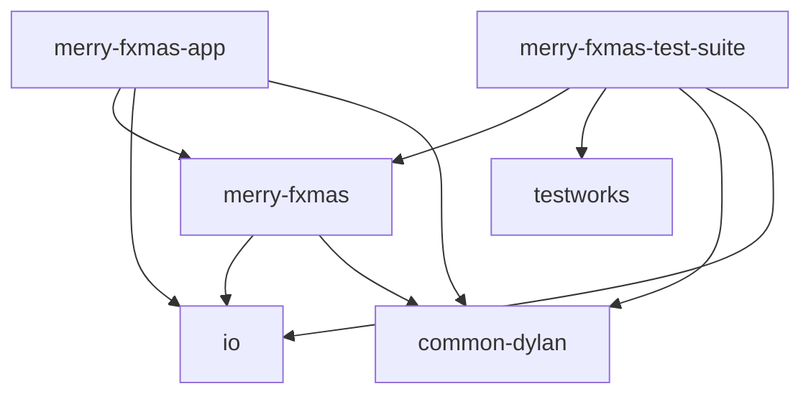
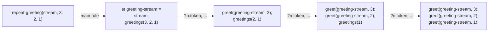

# merry-fxmas-dylan

[](https://github.com/FranklinChen/merry-fxmas-dylan/actions/workflows/build-and-test.yml)
[](LICENSE)

Say "Merry Christmas" 25 times, using a syntactic macro in Dylan.

The countdown is not produced by a loop. `repeat-greeting` is a recursive
Dylan macro that expands a list of literal tokens at compile time into that
many straight-line calls, so all 25 greetings exist in the generated code
before the program runs.

```
Merry Christmas Bill 25!
Merry Christmas Bill 24!
...
Merry Christmas Bill 2!
Merry Christmas Bill 1!
```

## Installing Open Dylan

On macOS, from the official tap:

```
$ brew tap dylan-lang/dylan
$ brew install opendylan
```

On other platforms, follow the instructions at
[opendylan.org/download](https://opendylan.org/download/).

This provides `dylan-compiler` and `deft`, the Dylan workspace and package
manager.

## Building and running

```
$ make          # deft update && deft build --all
$ make run      # print the 25 greetings
$ make test     # run the test suite
$ make clean    # remove everything generated
$ make ci       # test plus actionlint on the workflow (requires actionlint)
```

Every target is a thin delegation to `deft`, so you can drive it directly:

```
$ deft update             # install dependencies, generate registry/
$ deft build --all
$ ./_build/bin/merry-fxmas-app
$ deft test
```

The first build takes a while, because it compiles the Open Dylan runtime
libraries into the local `_build` directory.

## Continuous integration

The `build-and-test` workflow runs on every push and on pull requests to
`main`, on `ubuntu-latest` and `macos-latest`. Current pins, checked
2026-11-19:

- `actions/checkout` floats on `v7`, the tag whose release is `v7.0.1`.
- `dylan-lang/install-opendylan` is pinned to `v3.4.0`, with the compiler
  itself pinned to `v2026.2.0`, so an Open Dylan upgrade is a deliberate edit
  instead of an upstream default change.
- `actionlint` `v1.7.12` is installed from the release tarball and its
  sha256 is verified before the binary runs, rather than piping a script to a
  shell.

The build job does not trust `deft build`'s exit status: it asserts that the
real executables were produced, runs the application binary and checks its
first and last lines, then runs the Testworks suite. A separate `lint-workflow`
job lints the workflow itself with `actionlint`, which also shellchecks the
`run:` blocks. `make ci` reproduces the local part of the same pipeline.

## Layout

Three libraries, each described by a `.lid` file listing its sources and
target type.

| Path | Library | Target | Role |
| --- | --- | --- | --- |
| `src/lib/` | `merry-fxmas` | dll | The macro, `greet`, `write-greetings` |
| `src/app/` | `merry-fxmas-app` | executable | `main`, writes to standard output |
| `src/tests/` | `merry-fxmas-test-suite` | executable | Testworks suite |

`registry/` and `_packages/` are generated by `deft update` and are not
checked in.



The core library never mentions standard output; it writes to a `<stream>` it
is handed. The application picks `*standard-output*`, and the test suite picks
a string stream whose contents it can assert on. That seam is the only reason
the greetings are testable: the original 2012 version expanded directly to
`format-out`, so its only output channel was a global side effect.

## How the macro works

`repeat-greeting` has a main rule and one auxiliary rule set:

```dylan
define macro repeat-greeting
  { repeat-greeting(?stream:expression, ?greetings) }
    => { begin
           let greeting-stream = ?stream;
           ?greetings
         end }

greetings:
  { }               => { }
  { ?n:token, ... } => { greet(greeting-stream, ?n); ... }
end macro;
```

The main rule fires once: it binds the stream expression and hands the
remaining comma-separated tokens to the `greetings` rule set. An empty list
expands to nothing; a non-empty list expands to one `greet` call followed by
`...`, the recursive expansion of the rest.



### Why `greeting-stream` is not a pattern variable

This is the detail to know before editing the macro.

Auxiliary rule sets **cannot see the main rule's pattern variables**. Inside
the `greetings` rules, `?stream` is out of scope, so the stream cannot be
threaded down through the recursion as a pattern variable.

What auxiliary rules *can* see is an identifier the main rule's template
introduces, because every template in one macro definition shares a single
hygienic lexical environment. So the main rule binds a plain, non-`?`
identifier with `let`, and the auxiliary rules refer to it by that bare name.
Hygiene keeps the binding invisible to the caller, so it cannot capture or
collide with anything at the call site.

This is not a local invention. Open Dylan's own `with-ops-in-aux` macro, in
`sources/harp/core-harp/harp-macros.dylan`, uses the same technique: its main
rule writes `let inst-set = ?instruction-set;` and its `names-as-calls`
auxiliary rule then refers to the bare `inst-set`.

A useful consequence: the stream expression is evaluated **exactly once**, no
matter how many greetings are generated. Threading it through a recursive call
of the main macro instead would re-evaluate it per greeting.

The token list is comma-separated because the sequence pattern is written
`{ ?n:token, ... }`. The 2012 version used whitespace separation with
`{ repeat-greeting(?n:token ...) }`. Both are valid Dylan; the comma form is
what Open Dylan's own macros use, for instance `update-op`'s
`{ ?key:token, ?val:expression, ... }`.

## Types, and two deliberate absences

`<countdown>` is `limited(<integer>, min: 1)`, and `greet` takes one. A
greeting at position zero or a negative position is unrepresentable rather
than merely discouraged, so `greet` contains no range check and no caller can
forget one. Every greeting funnels through `greet`, so the invariant is
enforced in one place.

**There is no test that `greet` rejects position 0.** The type carries that
invariant, so a test for it would be a runtime guard for something the
compiler already refuses.

**There is no upper bound on `<countdown>`.** Symmetry argues for one, but name
a wrong value the type still permits and ask what would notice:
`greet(stream, 1000000)` prints a greeting for position one million and nothing
downstream cares, since no array is indexed and no buffer sized. A `max` tied
to the countdown length would also conflate "a valid greeting position" with
"a position in this particular 25-long countdown", coupling a general type to
one caller. The `min` bound is different in kind: zero and negative positions
are meaningless for any countdown.

Relatedly, the library exports no greeting-count constant. The literal token
list in `write-greetings` is the single source of truth for the length; a
hand-written count beside a hand-written list is two encodings of one fact
with nothing keeping them in agreement. The test suite declares its own
expected count, which makes it a genuine independent expectation.

## Testing

The suite uses [Testworks](https://github.com/dylan-lang/testworks) and
captures output with `with-output-to-string`.

`expected-countdown` builds the expected text with `write` and
`integer-to-string`, deliberately **not** with `format`. Sharing the
implementation's formatting call would let a formatting bug appear on both
sides of the assertion and the test would pass anyway.

The macro is tested on short lists as well as through the production
25-element call. The short list is deliberately unsorted (`1, 7, 4`): it proves
in one assertion that multiple tokens expand, that they expand in argument
order, and that the macro imposes no order of its own. A descending list such
as `3, 2, 1` would not distinguish those. A separate test counts how many
times the stream expression is evaluated with a closure, so the
exactly-once binding the macro relies on is pinned down by a test, not only by
the README.

## License

[MIT](LICENSE), which is the Dylan ecosystem's convention: Open Dylan's own
`License.txt` is the MIT text, and `deft`, `install-opendylan`, and the package
catalog are all MIT.

Copyright (c) 2012-2026 Franklin Chen.
